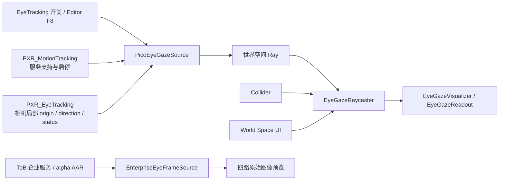
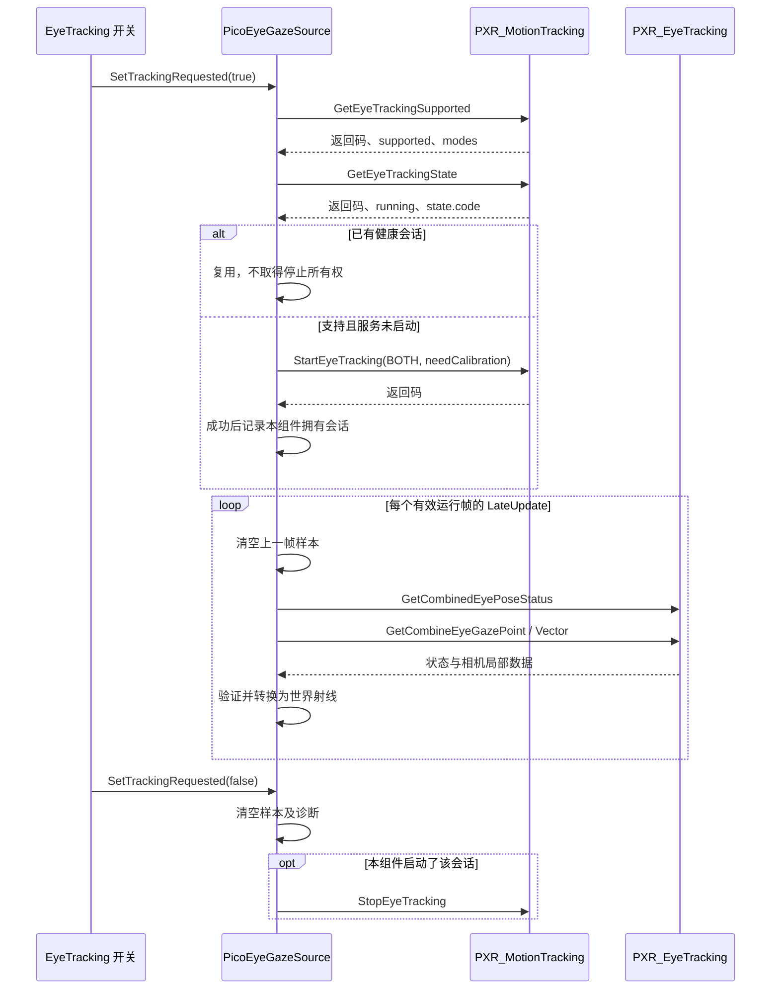

# XRoboToolkit EyeTracking 接入指南

更新日期：2026-11-06。适用读者：维护本项目的 Unity、Android 开发人员。

本项目使用 PICO Unity SDK 6.1.1 获取双眼合成注视数据，并在 Unity 中显示注视射线和场景落点。基础接入复用现有 `PicoEyeGazeSource`，企业服务的 EyeFrame 原始图像采集作为独立功能接入。[Data-backed]

文中的 `[Data-backed]` 表示已核对项目配置、代码、SDK 声明或已有验证记录；`[Expert judgment]` 表示工程建议；`[Hypothesis]` 表示仍需设备或 SDK 方确认的假设。代码示例和流程图跟随所在段落的证据标记。

## 1 选择需要的数据

注视起点与方向定义一条射线；射线与场景表面的交点定义落点。EyeFrame 则是一帧原始相机图像，两者分别由 XR 和企业服务链路提供。[Data-backed]

| 需求 | 数据与接口 | 必需依赖 | 本项目状态 | 依据 |
| --- | --- | --- | --- | --- |
| 注视方向和场景落点 | `PXR_EyeTracking` 的 combined origin、direction、status；Unity 表面求交 | PICO XR、支持眼动的设备、眼动服务与授权 | 已有采样、有效性过滤、射线、落点和结果页 | [Data-backed] |
| 左右眼与合成眼原生位姿诊断 | `PXR_MotionTracking.GetEyeTrackingData` | PICO XR 眼动服务 | 已作为低频诊断查询；未替换逐帧注视链路 | [Data-backed] |
| 开合度、瞳孔、分眼位姿、眨眼 | `GetEyeOpenness`、`GetEyePupilInfo`、`GetPerEyePose`、`GetEyeBlink` | SDK 注释要求 PICO 4 Enterprise 及高级眼动 metadata | 尚未接入；Swan 适用性待确认 | [Data-backed] / [Hypothesis] |
| 四路原始眼部相机图像 | 企业 `EyeTrackingManager` 与 `EyeTrackingListener` | alpha ToB 客户端、企业服务、对应设备能力与授权 | 已有桥接和预览；真实图像格式与设备采集仍待验收 | [Data-backed] |

现有注视功能和 EyeFrame 预览均未接入 TCP 眼动字段或眼动采集文件。若需求包含同步到机器人端或离线分析，需要另行定义数据协议、时间基准、参考空间和有效性字段，不能从界面上有射线推断已经完成数据传输。[Data-backed] / [Expert judgment]

## 2 准备开发与设备环境

### 2.1 复用项目基线

当前版本以 [ProjectVersion.txt](../ProjectSettings/ProjectVersion.txt)、[manifest.json](../Packages/manifest.json) 和本地 [SDK package.json](../PICO%20Unity%20SDK/package.json) 为准。打开已有工程后，等待 Package Manager 与脚本编译完成。[Data-backed]

| 项目 | 当前配置或要求 | 依据 |
| --- | --- | --- |
| Unity Editor | `2022.3.16f1`；SDK 声明基线为 Unity `2022.3` / `15f1` | [Data-backed] |
| PICO SDK | 本地 PICO Unity SDK `6.1.1` | [Data-backed] |
| 包引用 | `"com.bytedance.pico.xr": "file:../PICO Unity SDK"` | [Data-backed] |
| XR 运行方式 | PICO XR；Loader 为 `ByteDance.PICO.XR.PXR_Loader` | [Data-backed] |
| C# 命名空间 | XR：`ByteDance.PICO.XR`；企业：`ByteDance.PICO.Enterprise` | [Data-backed] |
| 交互相关包 | XR Interaction Toolkit `3.0.3`、Input System `1.8.1`、XR Hands `1.4.1` | [Data-backed] |
| Android 平台 | 安装并使用该 Editor 对应的 Android Build Support、SDK/NDK、OpenJDK | [Expert judgment] |
| 本机已核验构建工具 | Unity 2022.3 自带 JDK `11.0.14.1`、Gradle `7.2`；本地 build-tools `32.0.0` | [Data-backed] |
| 当前 Android API 设置 | Min API `30`，Target API `31`；这是工程现值，不代表眼动 API 的最低要求 | [Data-backed] |
| AI 开发工具 | TRAE Editor for Unity、已有 PICO/Unity CLI；这些工具辅助开发，不是眼动运行时依赖 | [Data-backed] |

项目中虽安装 OpenXR `1.14.3`，当前注视实现仍按 PICO XR 编译和运行。旧 `PICO Unity Integration SDK` 目录为迁移回退材料，不是活动包。不要同时启用旧包、替换 XR Provider，或为接入眼动执行 Unity 6 新工程初始化；版本迁移需先评审方案。[Data-backed]

在项目根目录运行已有只读环境检查。包装脚本会选择本工程工作目录和已安装工具，不会隐式安装工具。工具选择详情见 [AI 开发环境说明](ai_development_environment.md)。[Data-backed]

```powershell
python tools/ai/dev_environment.py check
```

预期结果是确认 Unity、活动 PICO 包和 CLI 路径。若后续授权构建时出现 Java/Gradle 不匹配，先检查 **Edit > Preferences > External Tools** 是否引用本工程 Unity 2022.3 自带工具；已有失败记录涉及把 Unity 6 的 Gradle 9.1 与 JDK 11 混用。[Data-backed]

### 2.2 确认设备能力与授权

SDK 6.1.1 的 `StartEyeTracking`、`GetEyeTrackingState`、`GetEyeTrackingData` 注释列出 PICO Neo3 Pro Eye、PICO 4 Pro、PICO 4 Enterprise。实际接入应查询 `GetEyeTrackingSupported` 并验证有效样本，设备名称或系统服务存在本身不足以证明完整能力。[Data-backed] / [Expert judgment]

已有只读记录中的设备为 Swan B3110，系统版本 `6.2.0`、ToB 服务 `5.9.0`。这是 2026-11-03 的环境记录；后续 Swan 注视诊断取得了有效原生位姿和 XR 状态值。上述版本不能作为所有设备的最低支持版本，也不能扩展为高级眼动或原始图像 API 的兼容承诺。[Data-backed]

进行真实眼动验证前，需要由设备操作者确认系统眼动功能已启用、应用具有相应授权、系统眼动校准已完成，并保持正确佩戴和应用前台焦点。设备设置调整、APK 构建及覆盖安装按 [AGENTS.md](../AGENTS.md) 的操作授权要求执行。[Expert judgment] / [Data-backed]

## 3 配置工程并绑定场景

前提：工程已按上述基线打开，Console 没有阻止脚本加载的编译错误。已有实现位于 [Assets/Scripts/EyeGaze](../Assets/Scripts/EyeGaze)，主场景为 [Assets/Main.unity](../Assets/Main.unity)。[Data-backed]

### 3.1 启用项目和运行时眼动开关

1. 确认 **Project Settings > XR Plug-in Management > Android** 使用本项目 PICO XR Loader。[Data-backed]
2. 选中 [PXR_ProjectSetting.asset](../Assets/Resources/PXR_ProjectSetting.asset)，确认 `eyeTracking = 1`。[Data-backed]
3. 检查主场景的 [XR Origin (XR Rig) prefab](../Assets/InteractionTools/Prefabs/XR%20Origin%20%28XR%20Rig%29.prefab)，确认其 `PXR_Manager.eyeTracking = true`，并检查场景实例是否有覆盖值。[Data-backed] / [Expert judgment]
4. 保留项目 `PICO_XR` 和 SDK `ENABLE_PICO_XR_SDK` 编译符号；Android 原生调用使用 `PICO_XR && UNITY_ANDROID && !UNITY_EDITOR` 保护。[Data-backed]

项目配置控制打包声明，`PXR_Manager` 控制运行时启用。只修改其中一处可能分别造成缺少声明或运行时显示 `EyeTrackingDisabled`。当前两处眼动开关均已开启，项目 `eyetrackingCalibration = 0`，`enableETFR = 0`。[Data-backed]

### 3.2 核对 Manifest 声明

本地 [PXR_BuildProcessor.cs](../PICO%20Unity%20SDK/Editor/PXR_BuildProcessor.cs) 根据 PICO XR 项目开关，在 Android Manifest 处理中添加眼动权限和 application metadata。以下为当前配置对应的声明片段，供检查授权构建后的合并 Manifest 使用；不应据此重建已删除的自定义 `Assets/Plugins/Android/AndroidManifest.xml`。[Data-backed]

```xml
<uses-permission android:name="com.picovr.permission.EYE_TRACKING" />

<!-- Inside the application element. -->
<meta-data android:name="picovr.software.eye_tracking" android:value="1" />
<meta-data android:name="eyetracking_calibration" android:value="false" />
```

Manifest 声明、设备运行时授权、校准状态和佩戴状态是不同条件。当前 `PicoEyeGazeSource` 没有单独实现 `Permission.RequestUserPermission` 眼动弹窗，而是通过 SDK 返回码呈现授权或服务错误；普通 Android 相机权限不等同于眼动权限。[Data-backed]

### 3.3 保留程序集隔离

[XRoboToolkit.EyeGaze.asmdef](../Assets/Scripts/EyeGaze/XRoboToolkit.EyeGaze.asmdef) 引用 `ByteDance.PICO.XR` 和 `UnityEngine.UI`，并通过 `com.bytedance.pico.xr` 的版本定义启用该程序集内的 `PICO_XR`。这使 Editor 模拟和 Android SDK 调用可以保留在同一组业务组件中。[Data-backed]

```csharp
using UnityEngine;
#if PICO_XR && UNITY_ANDROID && !UNITY_EDITOR
using ByteDance.PICO.XR;
#endif
```

迁移或复制组件时，应一起保留 asmdef、SDK 引用和宏保护。旧命名空间 `Unity.XR.PICO`、`PICO.TobSupport` 不适用于当前活动 SDK。[Data-backed]

### 3.4 绑定相机、命中对象与结果页

已有主场景已经串联下表组件；接入其他场景时按同样关系绑定，并保留脚本的执行顺序。[Data-backed]

| 组件 | 要绑定的内容 | 执行顺序与职责 | 依据 |
| --- | --- | --- | --- |
| `PicoEyeGazeSource` | 显式指定 HMD 的 `gazeCamera` | `LateUpdate` 100；服务管理、采样和世界射线 | [Data-backed] |
| `EyeGazeRaycaster` | 同一个 source；`hitLayers`、`ignoredRoot`、World Space UI 开关 | `LateUpdate` 200；最近表面求交 | [Data-backed] |
| `EyeGazeVisualizer` | 同一个 raycaster；Resources shader | `LateUpdate` 300；射线和落点显示 | [Data-backed] |
| `EyeGazeReadout` | 同一个 source 与 raycaster | `LateUpdate` 400；结果页数值显示 | [Data-backed] |
| `EyeGazeToggle` | 主页面、结果页面绑定同一个 source | 复用 `SetTrackingRequested` 开关状态 | [Data-backed] |
| `EyeGazePageNavigation` | 主页面、结果页及各自导航控件 | 通过 CanvasGroup 切换主页面可见性和输入 | [Data-backed] |

项目存在多个 `MainCamera` 标记，建议始终显式指定 HMD 相机。`ignoredRoot` 应只覆盖需要排除的 Rig、相机偏移节点及手柄/手部几何体；若选择包含整个场景 UI 的共同父节点，也会排除目标面板。[Data-backed] / [Expert judgment]

结果页使用 [EyeGazeReadout.prefab](../Assets/InteractionTools/Prefabs/EyeGazeReadout.prefab)，由 Main 场景绑定实际采样源与 raycaster。射线 shader 位于 [Resources/EyeGazeUnlit.shader](../Assets/Resources/EyeGazeUnlit.shader)。切换页面时保留 source 和采集组件启用状态，避免隐藏页面同时结束采样。[Data-backed] / [Expert judgment]

预期结果：主页面 **EyeTracking**、**Results >** 打开的结果页开关和 Editor **F8** 共用同一激活状态；**Back** 只返回主页面。更多界面细节见 [注视可视化说明](eye_gaze_visualization.md)。[Data-backed]

图 1 展示当前两条数据链路。企业 EyeFrame 预览独立于 combined gaze，不参与注视落点计算。[Data-backed]



## 4 启动服务并获取当前帧注视

### 4.1 复用服务管理逻辑

前提：运行 Android Player、启用 PICO XR，完成设备授权与眼动配置。业务调用 `PicoEyeGazeSource.SetTrackingRequested(true)` 即可进入现有服务与采样逻辑；在 Editor 中，同一调用启用鼠标模拟。[Data-backed]

[PicoEyeGazeSource.cs](../Assets/Scripts/EyeGaze/PicoEyeGazeSource.cs) 首先查询支持状态，再查询当前会话。已有健康会话可直接复用；服务未启动时，以 `EyeTrackingMode.PXR_ETM_BOTH` 启动双眼追踪。若服务运行但状态错误，则记录错误并等待下一轮检查。[Data-backed]

图 2 为 Android 启用到逐帧读取的时序。所有 Unity 与 SDK 操作留在主线程，XR 焦点回调只更新标志。[Data-backed]



| 参数或条件 | 当前处理 | 依据 |
| --- | --- | --- |
| `serviceRetrySeconds` | 默认 2 秒，最小 0.5 秒；服务检查使用非缩放时间 | [Data-backed] |
| `requestCalibrationOnFirstStart` | 默认 false；开启后，仅对本组件首次启动的会话请求校准 | [Data-backed] |
| `EyeTrackingStartInfo.needCalibration` | `byte`；SDK 定义 `0` 为需要校准，`1` 为不需要 | [Data-backed] |
| 会话所有权 | 只停止本组件成功启动的会话，不停止复用的外部会话 | [Data-backed] |
| 关闭、暂停、组件禁用 | 清空样本与诊断；停止本组件拥有的会话 | [Data-backed] |
| Unity 或 XR 焦点丢失 | 暂停采样并清空显示；恢复后重新核验服务 | [Data-backed] |
| 无有效眼动 | 返回等待状态；不回退为头朝向，不复用上一帧射线 | [Data-backed] |

`WantEyeTrackingService()` 在 SDK 6.1.1 已标记为 `Obsolete(..., true)`，调用会产生编译错误。应使用上述 support/state/start 流程。[Data-backed]

### 4.2 验证有效性并转换坐标

当前逐帧读取依次调用 `GetCombinedEyePoseStatus`、`GetCombineEyeGazePoint`、`GetCombineEyeGazeVector`。三次 getter 都需成功，状态需有效，origin 和 direction 需为有限值，direction 需非零。[Data-backed]

`GetCombineEyeGazePoint` 返回相机局部坐标中的合成眼起点，单位为米；`GetCombineEyeGazeVector` 返回同空间的方向。世界坐标通过 HMD 相机变换得到，落点再由 raycaster 求交。此链路无需额外除以 1000、翻转轴，或再次应用头部位姿。[Data-backed]

```text
worldOrigin    = gazeCamera.TransformPoint(localEyeOrigin)
worldDirection = normalize(gazeCamera.TransformDirection(normalize(localDirection)))
landingPoint   = nearestSurfaceHit.Point
```

SDK 注释描述 combined status 为 `0/1`，但 2026-11-05 Swan 记录出现 `1539 = 0x603`、`515 = 0x203`。两者均包含 bit 0、bit 1；旧逻辑只接受 `status == 1`，会在读取向量之前拒绝这些样本。当前 [EyeGazeMath.cs](../Assets/Scripts/EyeGaze/EyeGazeMath.cs) 同时兼容文档状态 `1` 和这两位均有效的状态值。[Data-backed]

| combined status | 当前判断 | 依据 |
| --- | --- | --- |
| `0` | 无效 | [Data-backed] |
| `1` | 按 SDK 文档的 Boolean 有效值兼容 | [Data-backed] |
| `2` 或缺少所需位的其他值 | 无效 | [Data-backed] |
| 同时包含 bit 0、bit 1，如 `3`、`515`、`1539` | 通过状态判断；仍需 getter 与数值验证 | [Data-backed] |

以下方法展示单帧读取，使用项目已有的公共数学函数。调用前应完成上一节服务初始化；完整生命周期直接复用 `PicoEyeGazeSource`。[Data-backed]

```csharp
private static bool TryReadCombinedGaze(Camera gazeCamera, out Ray worldRay)
{
    worldRay = default;
#if PICO_XR && UNITY_ANDROID && !UNITY_EDITOR
    if (gazeCamera == null || !gazeCamera.isActiveAndEnabled)
        return false;

    if (!ByteDance.PICO.XR.PXR_EyeTracking.GetCombinedEyePoseStatus(out uint status) ||
        !Robot.EyeGazeMath.IsCombinedEyePoseValid(status))
        return false;

    if (!ByteDance.PICO.XR.PXR_EyeTracking.GetCombineEyeGazePoint(out Vector3 localOrigin) ||
        !ByteDance.PICO.XR.PXR_EyeTracking.GetCombineEyeGazeVector(out Vector3 localDirection))
        return false;

    return Robot.EyeGazeMath.TryCreateWorldRay(
        gazeCamera.transform, localOrigin, localDirection, out worldRay);
#else
    return false;
#endif
}
```

`HasValidSample` 还要求样本来自当前 `Time.frameCount`。消费者应先判断这一属性，再读取 `WorldRay`；否则得到的是清空后的默认值。射线采样频率跟随渲染帧，不等同于 SDK 原生传感器频率或项目 Head/Controller 的高频采集配置。[Data-backed]

### 4.3 获取真实落点

前提：当前帧射线有效，目标具有可参与求交的 Collider 或 World Space UI Graphic。[Data-backed]

1. 给需要注视落点的普通场景网格添加与可见表面匹配的 Collider。[Expert judgment]
2. 确认 World Space Canvas 和对应 Raycaster 启用，目标 Graphic 的 `raycastTarget` 开启，未被 mask 或 `CanvasGroup.blocksRaycasts` 过滤。[Data-backed]
3. 检查 `hitLayers` 与 `ignoredRoot`，并将目标放在默认最大距离 10 个 Unity 世界单位内；Rig 为单位缩放时按米解释。[Data-backed]
4. 判断 `EyeGazeRaycaster.HasValidRay` 后，再判断 `HasHit`；只在命中时使用 `Hit.Point`、`Hit.Normal`、`Hit.Distance`、`Hit.Target`。[Data-backed]

Collider 和 World Space UI 共同竞争最近表面，因此前方物体会挡住后方 UI。物理求交忽略 Trigger，默认排除 Ignore Raycast 层，且剔除 Rig 后代；64 个命中缓存填满时改用完整查询，避免漏选最近目标。[Data-backed]

有效射线没有命中时，`EndPoint` 为最大距离端点，不是实际注视落点；界面保留方向线，落点和目标显示 `--`。无效样本则隐藏射线与落点。真实眼动显示青绿色，Editor 模拟显示橙色，默认线宽 2 mm、落点直径 16 mm。[Data-backed]

Screen Space Canvas 不参与当前世界 UI 求交。若 UI 经 RenderTexture 投射到曲面或网格屏幕，需要为显示表面提供匹配 Collider。当前 raycaster 只计算位置，不发送 pointer、hover、click 事件；注视停留点击或与手势点击联动需另行接入交互逻辑。[Data-backed] / [Expert judgment]

## 5 在 Editor 中验证接入

前提：打开 Main，进入 Play mode，并让 Game view 获得键盘焦点。Editor 无法通过该路径验证真实眼动 SDK，使用的是明确标记为 `SIMULATED` 的模拟数据。[Data-backed]

1. 勾选主页面 **EyeTracking**，或按 **F8** 启用鼠标注视模拟。[Data-backed]
2. 移动鼠标到 Game view 内目标上，检查橙色方向线与落点；打开 **Results >** 查看状态、世界起点、方向、目标和距离。[Data-backed]
3. 按 **F9** 切换模拟有效性，检查无效时射线和旧数值清空；再次按 F9 恢复。[Data-backed]
4. 在主页面或结果页关闭 EyeTracking，检查两个开关与 F8 激活状态一致。[Data-backed]
5. 使用 **Back** 返回，检查导航没有结束仍开启的采样；独立 EyeFrame 侧板可与结果页并存。[Data-backed]

也可在 source Inspector 中选择 `Editor Gaze Mode = Camera Local Direction`，设置局部 origin、direction 验证相机变换。模拟字段与 F8/F9 快捷键不会编入 Android Player。[Data-backed]

当前 XRI Editor 模拟器支持按住右鼠标移动鼠标旋转头部、配合 W/A/S/D/Q/E 平移；释放右鼠标后再用鼠标操作 UI。该模拟器的头/手柄控制与橙色眼动模拟独立，详细按键见 [注视可视化说明](eye_gaze_visualization.md)。[Data-backed]

已有只读资源校验命令如下，检查版本、GUID、file ID、prefab 与 Main 绑定，本次文档核对中已通过。[Data-backed]

```powershell
python tools/ai/validate_eye_gaze.py --assets-only
```

以下完整命令额外使用已有 Unity 编译引用检查 Editor 和 Android C#，不运行 Gradle、IL2CPP 或 APK 打包。若缺少新 SDK 对应的编译响应文件，需要先恢复 Unity 脚本编译缓存。[Data-backed]

```powershell
python tools/ai/validate_eye_gaze.py
```

Unity 菜单 **Tools > XRoboToolkit > Validate Eye Gaze** 会在临时 additive 场景中检查坐标、无效向量、Collider、World Space UI、遮挡、过滤、shader 和 prefab 引用，并恢复活动场景。脚本或资源校验通过仍需 Play mode 验证界面操作，也需真机验证校准与双眼渲染。[Data-backed]

## 6 分阶段验证真机结果

前提：已获本次构建、安装和必要设备操作的授权；使用当前工程生成的 APK，并记录实际包名、版本、设备型号和系统版本，避免把旧 APK 结果归入新实现。[Data-backed] / [Expert judgment]

| 阶段 | 验证操作 | 应观察的结果 | 依据 |
| --- | --- | --- | --- |
| 服务启动 | 佩戴设备，在前台勾选 EyeTracking | 通过支持/状态/启动检查；随后独立验证有效样本 | [Expert judgment] |
| 眼动有效性 | 保持头部相对稳定，分别注视不同目标 | 结果页为真实 `Valid`，方向和落点随注视变化 | [Expert judgment] |
| 坐标与头部运动 | 注视固定世界目标，同时缓慢转头或平移 | 世界落点保持与目标相符，不出现额外头部变换造成的漂移 | [Expert judgment] |
| 表面求交 | 注视普通 Collider、World Space UI、被遮挡 UI、无表面方向 | 最近表面命中正确，无表面时仅显示方向线 | [Expert judgment] |
| 数据失效 | 摘下或遮挡设备，观察实际失效状态 | 无效后清空旧射线、落点和诊断显示 | [Expert judgment] |
| 生命周期 | 切换前后台、恢复、关闭后再启用 | 暂停时无旧样本；恢复后重查服务，重新取得有效数据 | [Expert judgment] |
| 精度与稳定性 | 在完成校准后测量多目标误差与持续运行表现 | 记录角度/落点误差、有效帧比例、恢复耗时和异常日志；阈值由项目验收约定 | [Expert judgment] |

已有 2026-11-05 记录将 16 个有效原生合成眼快照与 Head 采集在 5 ms 内对齐，眼部位置跟随 Head 的 tracking position，偏移中位数约 5.9 mm。这支持“原生位姿已包含 tracking-space 头部运动”的判断，但样本数量和诊断用途不足以构成校准精度或长期稳定性结论。[Data-backed] / [Expert judgment]

原生 `GetEyeTrackingData` 的位姿不能直接代入第 4 节的相机局部变换，否则可能重复应用头部运动。若后续替换数据路径，需要核实原生参考空间，以同空间 Head 位姿重定位，或使用明确的 tracking-space 到 world 变换。当前生产射线仍使用 XR 相机局部 getter。[Data-backed] / [Expert judgment]

已有采集包为 [EyeGaze_20261105_211509.zip](../PulledData/EyeGaze_20261105_211509.zip)。文档整理未新增 APK 构建或设备安装结果；校准精度、完整生命周期、设备立体显示和长期运行仍按本节补充验收。[Data-backed]

## 7 根据状态和日志排障

### 7.1 区分服务状态与样本状态

结果页的 `Service code` 显示最近一次支持、状态或启动操作的返回码。`0` 表示该 SDK 操作成功，不能单独证明本帧眼动有效。数值默认每 0.1 秒刷新，关闭或失效时立即清空旧值。[Data-backed]

`Last eye data code` 和 `Last pose valid (L/R/C)` 来自独立 `GetEyeTrackingData` 诊断，每 `max(2, serviceRetrySeconds)` 秒读取一次。诊断请求 `PXR_EYE_POSITION | PXR_EYE_ORIENTATION`，`displayTime = 0` 为当前使用的保留字段值；每次新建 `PerEyeData[3]` 并设置 API version 1，避免失败查询残留旧有效标志。索引分别为 Left 0、Right 1、Combined 2。[Data-backed]

| 显示或状态 | 意义 | 优先检查 | 依据 |
| --- | --- | --- | --- |
| `EyeTrackingDisabled` | `PXR_Manager` 不存在或眼动未开启 | Rig 管理组件及场景覆盖值 | [Data-backed] |
| `UnsupportedDevice` | 查询显示设备不支持 | 设备能力、固件、SDK 支持结果 | [Data-backed] |
| `ServiceUnavailable` | 支持/状态/启动操作失败，或运行会话状态错误 | `LastSdkResult`、授权、模式与服务日志 | [Data-backed] |
| `MissingCamera` | 相机未绑定或未启用 | 显式 HMD 相机绑定、相机激活状态 | [Data-backed] |
| `Suspended` | 应用暂停或失去 Unity/XR 焦点 | 前台焦点、系统弹窗、佩戴状态 | [Data-backed] / [Expert judgment] |
| `WaitingForValidPose` / `NO DATA` | 本帧未取得有效 origin 和 direction | 下表失败阶段、校准、原始状态与原生诊断 | [Data-backed] |
| `SIMULATED` | Editor 模拟数据 | 只用于界面和数学验证 | [Data-backed] |

| `EyeGazeSampleFailure` | 失败发生位置 | 依据 |
| --- | --- | --- |
| `StatusUnavailable` | XR status getter 失败 | [Data-backed] |
| `PoseInvalid` | combined status 未通过有效性判断 | [Data-backed] |
| `OriginUnavailable` | 相机局部 origin getter 失败 | [Data-backed] |
| `DirectionUnavailable` | 相机局部 direction getter 失败 | [Data-backed] |
| `InvalidValues` | NaN、Infinity、零方向等数学验证失败 | [Data-backed] |

### 7.2 解释常用 SDK 返回码

返回码定义来自本地 [PXR_Type.cs](../PICO%20Unity%20SDK/Runtime/Scripts/Utils/PXR_Type.cs)。调用返回码、`EyeTrackingState.code`、XR combined status 和 native `isPoseValid` 属于不同字段，应分别记录。[Data-backed]

| 返回值 | 枚举 | 处理建议 | 依据 |
| --- | --- | --- | --- |
| `0` | `PXR_MT_SUCCESS` | 继续检查 running/state 或本帧 pose | [Data-backed] |
| `-1` | `PXR_MT_FAILURE` | 保存失败 API 与上下文日志 | [Data-backed] / [Expert judgment] |
| `-2` | `PXR_MT_MODE_NONE` | 检查模式；当前使用 SDK 的 BOTH 枚举 | [Data-backed] |
| `-3` | `PXR_MT_DEVICE_NOT_SUPPORT` | 查询设备与固件能力，停止假定支持 | [Data-backed] / [Expert judgment] |
| `-4` | `PXR_MT_SERVICE_NEED_START` | 进入服务启动流程 | [Data-backed] |
| `-5` | `PXR_MT_ET_PERMISSION_DENIED` | 检查合并 Manifest 和设备眼动授权 | [Data-backed] / [Expert judgment] |

### 7.3 定位 NO DATA 与落点问题

`[EyeGaze] Pose diagnostics` 包含失败阶段、`xrCombinedStatus`、服务/数据返回码、原生 L/R/C 有效标志、合成眼位姿和有效/无效样本计数。日志已限频；先保存这些原始字段，再判断数据路径。[Data-backed]

1. 检查 SDK 服务返回码；非零时先处理支持、授权或启动失败。[Expert judgment]
2. 检查 `sampleFailure` 与原始 combined status；遇到 `0x603` / `0x203` 时确认 APK 已包含当前位掩码兼容逻辑。[Data-backed] / [Expert judgment]
3. 对比 XR 样本和低频 native 诊断。两者都无效时，检查系统眼动启用、校准、佩戴和前台焦点；native 有效但 XR 无效时，优先分析 XR getter、有效性过滤与参考空间兼容性。[Expert judgment]
4. 在必要设备条件恢复后，关闭再开启 EyeTracking，并记录服务重查和样本恢复结果。[Expert judgment]
5. 若射线有效但无落点，检查 Collider、Canvas 类型、raycastTarget、层过滤、ignoredRoot、最大距离和遮挡；不要把这一情况当成眼动服务失败。[Data-backed] / [Expert judgment]
6. 若落点随头部运动异常偏移，检查相机选择、Rig 缩放和数据空间，尤其避免把 native tracking-space pose 当作 camera-local pose。[Expert judgment]

使用已安装 adb 读取日志，不清空设备日志；多设备环境通过 `-s` 选择本次目标。以下为单设备示例，输出为空只代表当前缓冲区没有匹配日志。[Expert judgment]

```powershell
adb logcat -d -v threadtime | Select-String 'EyeGaze|EnterpriseEyeFrames'
```

## 8 按需接入 EyeFrame 原始图像

前提：需求明确包含原始图像，alpha ToB 客户端与设备企业服务能力已核对。基础 combined gaze 接入无需先启用 EyeFrame。[Data-backed]

### 8.1 保留正确的 Android 依赖

当前企业预览通过 Java 桥接访问 alpha AAR 中的眼动接口。保留活动 SDK 路径下的客户端和适配器，避免重复企业 Java 类；详情见 [Enterprise EyeFrame 预览说明](enterprise_eye_frame_preview.md) 与 [SDK 迁移报告](../pico_sdk_6_1_1_migration_report.md)。[Data-backed]

| Android 依赖 | 当前选择 | 原因 | 依据 |
| --- | --- | --- | --- |
| `PICO Unity SDK/Enterprise/android/tobservicelib-0.6.0-alpha.0.aar` | 启用 Android 导入 | 提供现有企业客户端和 EyeFrame API | [Data-backed] |
| SDK `tobservicelib-release.aar` | 不参与 Android 导入 | 避免与 alpha 客户端重复 Java 类 | [Data-backed] |
| SDK `tob_api-release.aar` | 保留启用 | 适配新企业 wrapper 与 alpha 客户端接口 | [Data-backed] |
| 应用 `capturelib-0.0.7.aar` | 保留现有相机链路 | 现有应用相机 JNI ABI | [Data-backed] |
| SDK `capturelib-release.aar`、`CameraRenderingPlugin.aar` | 禁用 Android 导入 | 避免与应用相机 ABI 冲突 | [Data-backed] |

### 8.2 启动采集与接收帧

以下方法签名已通过实际 alpha AAR 的字节码和反射核对。[Data-backed]

```java
ToBServiceHelper.getInstance().getEyeTrackingManager();
void setListener(EyeTrackingListener listener);
int setConfig(EyeOutputConfig config);
int startCapture();
int stopCapture();
```

1. 复用项目企业服务绑定流程，待绑定成功后获取 `EyeTrackingManager`。[Data-backed]
2. 设置 `EyeOutputConfig.targetFps = 30`，调用 `setConfig` 并检查返回值；接口配置范围为 30 至 90 Hz。[Data-backed]
3. 注册 `EyeTrackingListener`，再调用 `startCapture`，检查返回码。[Data-backed]
4. 在 `onFrameAvailable(EyeFrame)` 中接收 `long timestamp`、`int id/width/height` 和 `byte[] data`；监听 `onError(int)`。[Data-backed]
5. 在 SDK 回调返回前复制数据所有权，使用现有有界缓冲和 JNI lease 桥接，避免直接跨线程持有 SDK 会复用的 byte 数组。[Data-backed]
6. 在 Unity 主线程获取帧并更新预览；停止、关闭、暂停或失焦时释放采集与 lease。[Data-backed]

| Camera ID | SDK 标签 | 解释 | 依据 |
| --- | --- | --- | --- |
| `15` | Top Left | 相机位置标签，尚未映射为解剖学左眼 | [Data-backed] |
| `16` | Top Right | 相机位置标签，尚未映射为解剖学右眼 | [Data-backed] |
| `17` | Bottom Left | 相机位置标签 | [Data-backed] |
| `18` | Bottom Right | 相机位置标签 | [Data-backed] |

原始时间戳按纳秒保留为 64 位整数。当前预览复制限制为每路最多 15 Hz，因此 `previewHz` 不等于请求的 30 Hz 或传感器采样率；超过两秒的旧帧会隐藏。EyeFrame 采集错误不自动重试，需要显式停止/启动或重新勾选。[Data-backed]

当前像素解释按紧凑 Gray8、`width * height` 字节实现。真实设备的格式、row stride、行序、方向和稳定尺寸仍需确认；数组长度与合成帧测试不足以证明真实图像解释正确。**Flip Y** 只调整显示方向，不能作为传感器格式确认。[Data-backed] / [Hypothesis]

预期真机结果是四路 ID 持续收到帧、纳秒时间戳递增、尺寸与内容正确，并能通过 Stop/Start、关闭和服务断连验证资源释放。现有测试已覆盖实际 AAR 接口反射、合成帧复制和生命周期，但真实 EyeFrame 采集与渲染仍待验收。[Data-backed] / [Expert judgment]

## 9 高级眼动与后续扩展

本地 SDK 对 `GetEyeOpenness`、`GetEyePupilInfo`、`GetPerEyePose`、`GetEyeBlink` 注释限定 PICO 4 Enterprise，并要求 application 内的 metadata。基础 combined gaze 不以这一高级开关为前提。[Data-backed]

```xml
<meta-data android:name="pvr.app.et_tob_advance" android:value="true" />
```

若产品需要这些字段，应先确认 Swan 或目标机型的固件、授权和接口能力，再规划 Manifest 合并方式、采样及协议扩展。当前尚不能据 SDK 中存在方法就宣称目标设备提供有效高级数据。[Expert judgment] / [Hypothesis]

| 扩展方向 | 需要补齐的定义或验证 | 依据 |
| --- | --- | --- |
| TCP 同步 | 字段版本、显式数值类型、origin/direction 参考空间、无效数据表达 | [Expert judgment] |
| 离线采集 | timestamp 来源与时钟域、与 Head 对齐方式、采集频率、丢帧与 meta.json 配置记录 | [Expert judgment] |
| 原生位姿替换 XR getter | tracking-space 定义、tracking origin/recenter 处理、同时间 Head 变换 | [Expert judgment] |
| 注视点击 | 停留或确认事件、与现有 UI 事件和手势输入的关系 | [Expert judgment] |
| EyeFrame 数据保存 | 原始像素格式、stride、每帧元数据、吞吐和缓冲压力 | [Expert judgment] |
| 完整上线验收 | 校准精度、有效帧比例、生命周期恢复、双眼显示、持续运行稳定性 | [Expert judgment] |
